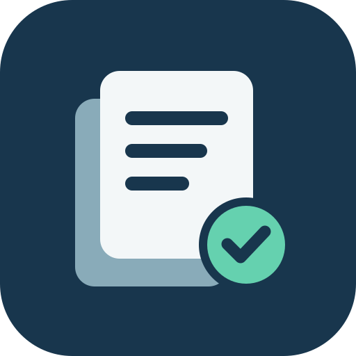

# Maintain Project State

[English](README.md) | 简体中文



为编码 Agent 维护简洁、有仓库证据支持的项目快照，帮助跨会话理解项目、恢复工作和交接。

快照记录项目用途、架构、约定、已实现能力、进行中工作、风险、开放决策和验证边界；源码、测试、日志及已接受设计保持权威。

## 兼容性

本 skill 使用 [Agent Skills 格式](https://agentskills.io/specification)。工作流需要读取项目文件和检查 Git；更新还需要所选状态文件的写权限。发现机制、安装目录和项目指令文件按宿主 Agent 的约定使用。

核心流程不依赖 Codex 专属 API；`agents/openai.yaml` 提供可选的 Codex 展示配置。**实际测试仅覆盖 Codex，其他 Agent 尚未验证。**

## 安装

仓库：[worldtheater/maintain-project-state](https://github.com/worldtheater/maintain-project-state)。

其他 Agent 请按其支持的 Agent Skills 安装机制安装仓库根目录。包含 `SKILL.md`、`assets/` 和 `LICENSE`；使用 Codex 展示配置时保留 `agents/`，不要复制 `.git`。

### Codex

在 Codex 中请求：

```text
$skill-installer 从 https://github.com/worldtheater/maintain-project-state 安装仓库根目录的 maintain-project-state skill
```

也可克隆仓库，将 `SKILL.md`、`agents/`、`assets/` 和 `LICENSE` 复制到以下目录之一：

- 个人使用：`~/.agents/skills/maintain-project-state/`。
- 项目使用：目标项目的 `.agents/skills/maintain-project-state/`。

安装后开始新的会话；未显示时重启 Codex。通过 `/skills` 查找，或使用 `$maintain-project-state` 调用。安装位置参见 [Codex 官方说明](https://developers.openai.com/codex/skills)。

## 使用

- “查看项目进展并核对相关证据，不修改文件。”
- “初始化当前仓库的项目状态。”
- “更新项目状态，为换会话继续工作做交接。”

默认状态文件为项目根目录的 `.codex/project-state.md`。这只是可配置的文件位置约定；用户或项目指定的路径优先。不同 Agent 共用同一份状态，不按工具再建副本。

查询状态只读；初始化和维护需要用户或仓库指令授权。实现、验证与未提交工作分别记录。skill 不授权自动提交、推送或修改仓库指令文件，也不会绕过文件写入权限。

## 更新与验证

已安装的 skill 是本地副本，可能需要明确重新安装或更新。覆盖前保留本地修改。

[TESTING.zh-CN.md](TESTING.zh-CN.md) 记录已发布 `v0.1.1` 快照在 Codex CLI 中执行的十项行为测试和 GitHub 安装检查。这些历史结果不代表其他 Agent 已验证。本次通用定位和文档调整仅做格式与文档检查，没有重跑行为测试。

已测试的旧版 [v0.1.1 源码 ZIP](https://github.com/worldtheater/maintain-project-state/archive/refs/tags/v0.1.1.zip) 仍可下载；获取当前定位与文档请从默认分支安装。

## 许可

作者：**worldtheater**。采用 [MIT License](LICENSE)，再分发时请保留版权与许可声明。
